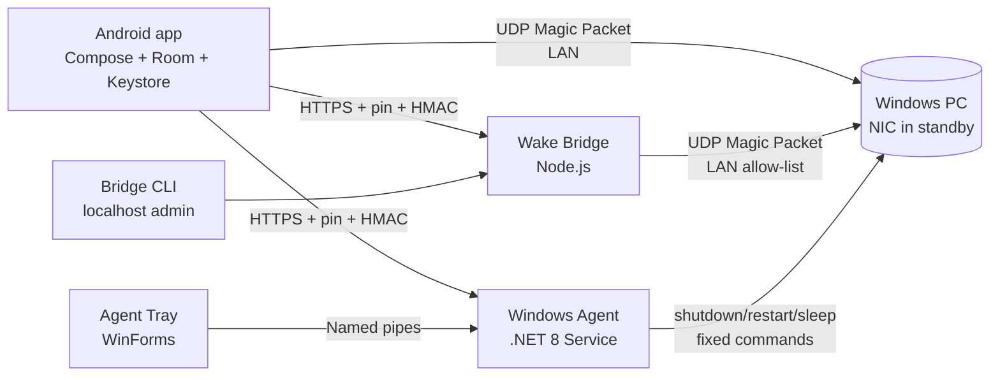

# Architecture and design decisions

## Components

Three trust domains:

1. **Phone** holds credentials in Android Keystore and talks only over pinned
   HTTPS for control; WoL is fire-and-forget UDP.
2. **Windows agent** serves a fixed power API, stores hashed tokens and audit
   under a System/Administrators ACL, and is separate from its interactive tray.
3. **Wake Bridge** is a minimal always-on HTTPS relay that can only send magic
   packets to configured MACs.

## Data flow

### Local wake

1. User taps Power on; app parses/validates MAC and broadcast.
2. `WolSender` opens a UDP socket with `SO_BROADCAST`, optionally bound to the
   chosen interface, and writes 102-byte magic packets, default 3× at 500 ms.
3. History records `SENT` with datagram count/port. No boot is claimed.
4. If the PC has a paired agent, the app polls `status` and only then reports
   **Online**.

### Remote wake

1. App signs a `wake` request with the bridge token (HMAC canonical string).
2. Bridge validates timestamp/nonce/signature/rate limit and MAC allow-list.
3. Bridge writes magic packets from its own config's broadcast/port.
4. Response reports `sent`; it does not imply boot.

### Power commands

1. App shows a confirmation dialog and sets UI progress.
2. Sends signed `POST /api/v1/power/{action}` with clamped grace.
3. Agent validates auth, single-pending-command rule, then schedules the fixed
   Windows action; returns 202 with command id/grace.
4. Windows shows its native shutdown warning; tray shows a visible pending
   notification and can cancel (`shutdown /a`).
5. App records `ACCEPTED`. Agent status later reports executed/cancelled/failed.

## Status semantics (deliberate)

| App status | Meaning |
|---|---|
| Online | Authenticated `/api/v1/status` succeeded |
| Offline | An accepted shutdown/sleep/restart was followed by no agent response |
| Unknown | Agent unreachable; may be off, asleep, on another network, or pin/agent issue |
| Wake-only | No agent paired; only wake is possible |
| Checking | Status request in flight |

ICMP is intentionally not used. Ping failure cannot distinguish a powered-off
PC from a firewall/network change.

## Design decisions

### Android: one Gradle module, layered packages

The requested separation (core/data/domain/networking/security/ui/database) is
enforced by package boundaries in one app module. A single module keeps builds
fast and startup small for this app's size; multi-module overhead would not buy
isolation here. Room schema export lives in `app/schemas`.

**No DI framework:** a small `AppContainer` wires dependencies explicitly,
avoiding reflection/startup cost. ViewModels use a tiny factory.

**No Retrofit:** OkHttp + kotlinx.serialization keeps the request bytes explicit,
which matters because the signature covers the exact body bytes.

**Keystore vault:** AES-256-GCM key non-exportable in AndroidKeyStore; ciphertext
in private SharedPreferences. A plaintext index would leak endpoints, so the
index is encrypted too. Tokens never enter Room or logs.

**No permanent background service:** status polling runs only while a screen is
visible (lifecycle-scoped coroutines). This keeps battery/CPU low and avoids fake
"always monitoring" claims.

### Windows agent: service + tray

The service owns HTTPS, state, pairing and power. The tray is an interactive
session app for QR/code display, device management, and visible remote-command
notifications. They communicate only over ACL-restricted named pipes; the tray
never holds API tokens. PowerShell/WiX installers manage the service, firewall
and ACLs; uninstall is explicit. LocalSystem is used only because the power APIs
require shutdown privileges; the exposed surface is three fixed actions.

### Wake Bridge: zero dependencies

Node.js built-ins (https, crypto, dgram, fs) avoid npm supply-chain weight and
work on Raspberry Pi. Pairing is started only via a loopback admin API secured by
a random state-file token and surfaced by a CLI. Target allow-listing is enforced
server-side so a stolen phone token cannot wake arbitrary MACs.

### Protocol

One canonical string shared verbatim by all three implementations, with normative
test vectors (§8 of PROTOCOL.md) asserted in every test suite. Base64url without
padding for nonces/signatures; lowercase SHA-256 hex for pins/hashes.

## Scale and performance

- Status checks are per visible screen, bounded by 60 req/min/device, default
  15 s; parallel per PC but typically ≤ a handful.
- Packet retries configurable (1–20); no busy loops.
- Room indices on deviceId/timestamp; cascade deletes; history capped by query
  (500 in UI, database cleaned manually/clear all).
- Agent is idle except timers/requests; bridge is single-threaded Node; both are
  intended for Raspberry-Pi-class hardware.
- Android avoids large image assets, uses vector icons, R8/minify release.

## Failure and recovery

- Agent restarts with Windows; state/cert persist in ProgramData.
- Tray absent still yields the native Windows shutdown countdown.
- Bridge restart preserves hashed devices and audit; pairing codes are ephemeral.
- Network change on Android: checks fail to Unknown, no crash; WoL interface can
  be reset to Automatic.
- Certificate change is a hard pin failure requiring manual re-pair.
- Clock skew invalidates signed requests; automatic time is required.

## Build/release

- Android: Gradle, JDK 17, SDK 34; debug APK + signing instructions.
- Windows: `dotnet build/publish`, WiX MSI or PowerShell installer.
- Bridge: copy directory, systemd unit; no build step.
- License MIT; no paid service required.
